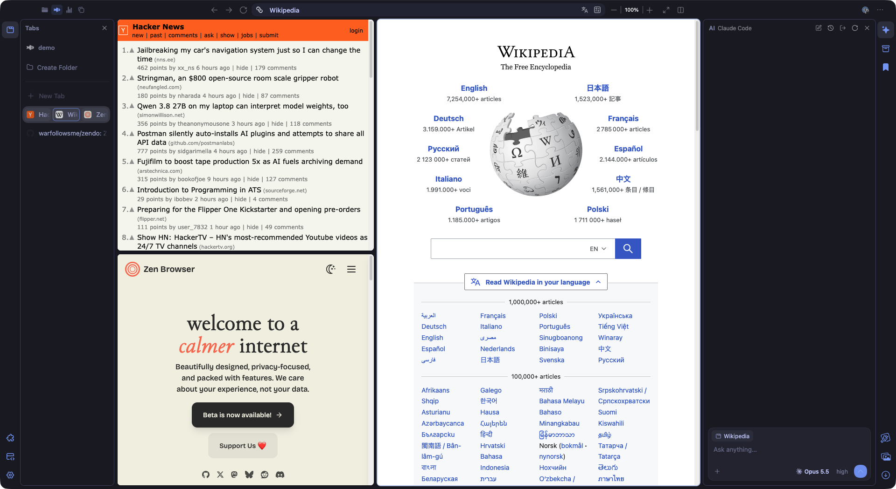

<h3>&nbsp;&nbsp;<code>Zendo</code></h3>

**[Zen](https://zen-browser.app), finished.** An IDE-like window layout, themes
and mods you switch with one command, and every setting a text file in your own
git repository. Missing something? Ask your AI agent — it writes the CSS or the
script and commits it, and the browser picks it up: CSS at once, scripts after
a restart.



- **A layout like an IDE.** Tool rails on both edges, island side panels in
  four zones, Zen workspaces as numbers in the top strip, links that a site
  opens in a new tab open in a split.
- **Everything is a file.** Themes, UI mods, site styles, scripts and `user.js`
  live in git. CSS applies a second after you save — no restart. Your personal
  layer can sync between machines through a repository of yours.
- **Your agent can change any of it.** The side panel works with Claude Code, a
  ChatGPT subscription, an API key or any OpenAI-compatible model; or run
  `claude` / `codex` in the terminal. Every change is a separate commit, and
  `git revert` undoes it. When a Zen update breaks a mod, ask the agent to fix
  it.

Zendo works fully without AI: the layout, themes and mods are plain files and
commands. If you know [Omarchy](https://omarchy.org), it's the same idea for a
browser — an opinionated base you own and change.

macOS and Linux ([Windows](#windows) isn't supported yet) · an unofficial
project, not affiliated with the Zen team · [MIT](#license)

## Install

```sh
curl -fsSL https://raw.githubusercontent.com/warfollowsme/zendo/main/install.sh | bash
```

You need [Zen](https://zen-browser.app), launched at least once (so it has a
profile), and git. The installer asks where to put Zendo and your personal
layer, connects Zendo to your Zen profile and adds the **Zendo** launcher —
start Zen with it from then on. The AI assistant additionally needs
[Claude Code](https://claude.com/claude-code), a ChatGPT account or an API key.

Platform notes, AppImage, Flatpak and removal — in
[Installation details](#installation-details).

## What's included

- **Themes:** Tokyo Night, Catppuccin Mocha, Gruvbox Dark, Nord, Rosé Pine Dawn.
- **Mods:** tab close button only on hover, monospace font in the address bar,
  accent stripe on the active tab, no Firefox sidebar, address bar suggestions
  as a separate island, slim address bar.
- **Sites:** YouTube without Shorts.
- **Scripts:** links that a site opens in a new tab open in a split to the
  right of the page (preview only via the "Open Link in Glance" item; turn off
  with `kit.links.split = false`), the layout with toolbars and side panels,
  the AI assistant, site name in the address bar, minimalist folder icons,
  "Copy as Markdown" in the tab menu (all need `--autoconfig`).

Themes, mods and site styles are toggled with `bin/theme`, `bin/mod`,
`bin/site` or in the **Settings** panel — see [Commands](#commands).


## Security

Zendo's browser scripts ([fx-autoconfig](https://github.com/MrOtherGuy/fx-autoconfig))
run with full browser privileges — files, cookies, everything the browser can
reach. The AI assistant can write them, but never without asking you. In
practice:

- **It asks first** before writing any script (`*.js`, `*.mjs`, `*.sh`…,
  `user.js` included) or anything in `bin/`, running JS on a page or in the
  browser window, closing a tab, opening an address it put together itself,
  running shell commands outside a short list,
  or editing files anywhere else (the full list is in
  [AI assistant](#ai-assistant)). The question shows the file and what goes
  into it. "Allow all in this chat" turns these questions off until the chat
  ends.
- **Without asking**, it reads tabs and pages, takes screenshots, edits CSS and
  other files that don't run as code (themes, mods, site styles, `AGENTS.md`)
  in the base and your personal layer, and commits them. It can't edit `.git/`
  at all. It also opens addresses somebody else wrote: on a site you named in
  the chat, seen as they are in a tab or on a page it read, or a search in
  your search engine. An address it composed could carry what it has read to
  someone else, so that one asks, and the card shows it in full.
- **Browser scripts and `user.js` take effect only after a restart** (↻ in the
  panel or the next launch). Site scripts (`sites/<name>.js`) run with page
  privileges in a sandbox, on pages opened after the change.
  `git -C ~/.config/zendo log -p` shows everything that was written.
- **A page can try to talk the agent into things** (prompt injection). The
  assistant is told to treat page text as data, not instructions, but that is
  not a guarantee: read what a script does before you allow it, and don't use
  "Allow all" while working with pages you don't trust.
- With Claude Code, the browser tools are served over MCP on 127.0.0.1 only,
  behind a one-time token, and the browser itself doesn't go online. With
  ChatGPT and API keys, the browser sends the model requests itself.

Only enable scripts written by you or the assistant, and read them first.

## Base and personal layer

- **Base** — `~/.local/share/zendo`, this repository. Updated with
  `bin/update`. Don't edit it by hand — the update won't apply over such edits.
- **Personal layer** — `~/.config/zendo`, your own git repository: your themes,
  mods, site styles, scripts, `user.js`, small CSS tweaks, the chosen theme and
  enabled mods. Updates don't touch it. A file with the same name as one in the
  base replaces the base file. What goes where — see
  `~/.config/zendo/README.md`.
- **Personal instructions for AI** — `~/.config/zendo/AGENTS.md`: which
  language to answer in, what to keep in mind.

By default the assistant writes your changes to the personal layer and commits
each one separately — anything that didn't work out can always be reverted
with `git revert`.

### Several devices

The personal layer is a git repository, so it moves between devices through a
repository of your own — a private one on GitHub, for example:

```sh
gh repo create zendo-personal --private          # once, on the first device
~/.local/share/zendo/bin/personal remote https://github.com/<you>/zendo-personal.git
~/.local/share/zendo/bin/personal push
```

On a new device, run the usual install command and give the installer your
repository when it asks (or set `ZENDO_USER_REPO=<url>`) — your layer is cloned
before Zendo connects to the profile (a private repository needs git access on
that device: `gh auth login` or an SSH key). After that, `bin/personal push`
sends your changes and `bin/personal pull` gets the ones made elsewhere.

What moves: themes, mods, site styles and scripts, JS/CSS, `user.js`, the chosen
theme and mods, `AGENTS.md`. What stays on each device (it lives in the Zen
profile): each space's theme, the window layout, AI sign-in. Bookmarks,
passwords and extensions are synced by Zen/Firefox itself.

## Window layout

At the top is the shared window strip: window buttons, Zen workspaces (like
desktops in Omarchy: the workspace icon or number, the active one highlighted,
click to switch; Create Space at the end); in the middle of the window, the
page group (back/forward/reload, address bar, zoom); on the right, full screen
and the **Split** button — its Add Right / Left / Top / Bottom Split menu
splits the focused tab in half, with the new pane on the chosen side (Zen's
split view, up to 4 panes; borders can be dragged with the mouse, the pane's
mini-menu has an × to close it). While the address bar isn't focused, it shows
the site name rather than the URL. In the center —
only the site. On the edges — toolbars with tool icons and island-style side
panels (like tool windows in an IDE):

| Tool | What's in the panel |
|---|---|
| Tabs | Zen tabs; Create Folder at the end of the folders |
| History, Downloads, Media, Boosts | sections of Zen's Library (its button is removed) |
| Bookmarks | Firefox bookmarks |
| Settings | theme, mods, site styles, layout reset |
| AI | the assistant (below) |
| Develop | browser console, Browser Toolbox, `bin/check`, scripts, errors |

The panel UI is in English, using Zen's own font and icons.

Clicking an icon opens or hides its panel. Icons can be dragged between four
zones — left top, left bottom, right top, right bottom: a panel opens in the
zone where its icon is. One side fits two panels (top and bottom); their width
and the border between them can be dragged with the mouse. The old Firefox
sidebar is removed (the `no-firefox-sidebar` mod).

## Commands

From the base folder (`~/.local/share/zendo`):

| Command | What it does |
|---|---|
| `bin/theme` | list themes; `bin/theme <name>` — the default theme, `bin/theme zen-default` — Zen's colors. Each space can have its own theme: the Theme list in Create Space and on top of Zen's space theme picker ("Zen" shows the picker's color controls) |
| `bin/mod` | UI mods; `bin/mod on <name>` / `bin/mod off <name>` |
| `bin/site` | site styles (and their `<name>.js` scripts, if any); `bin/site on <name>` / `bin/site off <name>` |
| `bin/update` | update the base from GitHub |
| `bin/voice` | voice input for the AI panel; `bin/voice setup` — install whisper.cpp and its speech model (~550 MB) |
| `bin/personal` | the personal layer's repository: `remote <url>`, `push`, `pull` (see [Several devices](#several-devices)) |
| `bin/sync` | rebuild the profile — after adding or removing a file in the personal layer |
| `bin/restart` | restart Zen; `--clear-cache` — after JS edits |
| `bin/status` | what's connected, current theme and mods, Zen versions |
| `bin/check` | check the base and personal layer without running Zen: imports, headers, JS syntax |
| `bin/zen-source` | download or update the Zen sources in `zen-source/` (the AI uses them to find selectors) |
| `bin/install` / `bin/uninstall` | connect / disconnect Zendo from the profile |
| `bin/app` | make the Zendo launcher (Zendo.app on macOS, a menu entry on Linux) — starts Zen after checking the script loader and the profile (`bin/launch`) |

The same things — themes, mods, sites — can be toggled in the **Settings**
panel.

## AI assistant

Open it with the ✦ AI icon on the toolbar (top right by default),
**Cmd+Shift+E**, or the "Ask the assistant" item in the page context menu (it
fills in the selected text). Or work from a terminal:

```sh
cd ~/.local/share/zendo
claude      # or codex
```

And just ask: "make a theme like Kanagawa", "hide the new tab button",
"add a hotkey that closes all tabs to the right", "move my extensions over from
Chrome". The agent knows the project structure, looks up selectors in the Zen
sources (`bin/zen-source`) and commits each change separately — anything that
didn't work out can always be reverted with `git revert`.

While nothing is connected, the panel offers to pick a method — you can
connect several at once: **Claude** (Claude Code), **ChatGPT** (a Plus/Pro/Team
account), an **API key** (Anthropic or OpenAI) or any **OpenAI-compatible**
service (OpenRouter, DeepSeek, Groq, Ollama, LM Studio…). Details are
[below](#connection-details).

**Voice.** The microphone button next to "+" or **Cmd+Shift+U**
(Ctrl+Shift+U on Linux; another one: `kit.ai.voice-key` in about:config, e.g.
`accel,alt+V`) listens for a spoken request. A pause of 1.5 seconds
ends it (or click / press the shortcut again); Esc cancels. Speech is recognized
on your computer by [whisper.cpp](https://github.com/ggml-org/whisper.cpp), in
any language, and sent as a message (if you had typed something, the speech is
added to it instead). Set it up once with `bin/voice setup`; macOS asks for
microphone access the first time.

While an approval card is waiting, a spoken "allow" or "deny" answers it
instead ("yes", "no", "разреши", "нет"…; your own words:
`kit.ai.voice-allow` and `kit.ai.voice-deny`). Only a phrase that is nothing
but the answer counts, and "Allow all in this chat" is never taken by voice.
The microphone hears everything around it, a video playing on a page too, so
start listening when the room is yours. With the keyboard: Tab to the card,
then Enter allows and Esc denies.

Besides files, the assistant has browser tools:

| Tool | What it does | Confirmation |
|---|---|---|
| `list_tabs`, `select_tab` | tabs | no |
| `open_url` | open an address | only one it put together itself |
| `get_page` | page text, links, form fields | no |
| `screenshot` | a screenshot of the page or the whole browser window | no |
| `query_browser_ui` | Zen UI markup by selector | no |
| `run_page_js` | JS on the page: clicks, forms, data collection | yes |
| `run_browser_js` | JS in the browser window — live edits until a restart | yes |
| `close_tab` | close a tab | yes |

Writing scripts (`*.js`, `*.mjs`, `*.cjs`, `*.sh`, `*.py`, `*.swift`) or
anything in `bin/`, shell commands other than
`bin/check|status|sync|theme|mod|site`,
`git [-C <base or personal layer>] status|diff|log|add|commit`, and `ls` and
`grep` inside the base and the personal layer, as well as edits to files
outside the base and the personal layer, also require confirmation in the
panel. You can click "Allow all in this chat".

The commands on that list are checked word by word, not by how they start
(`resources/kit-ai/policy.sys.mjs`, tested by `bin/check`): an option outside
the list — `git log --output=<file>` writes a file — a pipe, a redirect or
`$(…)` asks as well, and so do `cp`, `mv` and the like. Claude Code also reads
inside the base and the personal layer with its own read-only commands (`cat`,
`find`…) without asking. Rules you allowed in your own Claude Code settings
apply in the panel too.

The assistant writes permanent browser changes to files and commits them; to
apply them, press ↻ in the panel header: the browser restarts with the script
cache cleared, and the conversation continues where it left off.

### Connection details

<details>
<summary>Claude, ChatGPT, API keys, OpenAI-compatible services</summary>

- **Claude** — under the hood it's the same Claude Code as in the terminal: the
  panel runs `claude -p` in the Zendo folder, so the assistant knows AGENTS.md
  and can do everything described above — themes, mods, site styles, scripts.
  Sign-in is shared with the terminal (`claude auth login`); the panel only
  checks it via `claude auth status`.
- **ChatGPT** — sign in with a ChatGPT account (Plus/Pro/Team), no Codex CLI
  needed. An OpenAI sign-in tab opens; after you sign in, the browser picks up
  the token and closes the tab. Requests go to `chatgpt.com/backend-api/codex`
  the same way the official Codex does; OpenAI doesn't officially support it
  for third-party programs and may change it.
- **API key** — an Anthropic (`sk-ant-…`) or OpenAI key; billed at API rates.
  The key is verified by requesting the model list. Claude models over the API
  use `fallbacks: "default"`: if the safety filter rejects a request, the API
  retries it on a suitable model.
- **OpenAI-compatible** ("Other" in the API key form) — OpenRouter, DeepSeek,
  Groq, Ollama, LM Studio or your own address, with the Chat Completions API.
  The key is optional for a local server; the model can be typed in or picked
  from the server's list later. The model must support tools (function
  calling) — the assistant works through them; OpenRouter models without tools
  are hidden from the list. Weaker models make more mistakes when editing files.

Tokens and keys are stored in the password manager (about:logins →
`chrome://kit-ai`). ChatGPT and the API edit files with their own tools
(`read_file`, `search_files`, `edit_file`, `write_file`, `run_command`) — in the
base and the personal layer; they may not change `zen-source/`, `utils/`,
`program/` or `.git/`.

The panel header has new chat, history (conversations are stored in the Zen
profile, `kit-ai-chats/`, and resume where they left off), the accounts menu
(sign out of any of them or connect another) and ↻. Below the input field are
the model and the reasoning effort; the model can be changed mid-conversation,
while switching to another connection method starts a new chat. Files are
attached with the + button, by dragging them onto the panel or by pasting an
image (Cmd+V): images go to the model right in the message, as do PDFs and
text (Claude Code reads them from disk, from `kit-ai-attachments/` in the
profile). The pill with the tab title controls whether to share the active
tab and selected text; click to turn it off.

</details>

### How it works

<details>
<summary>Files, the MCP server, preferences</summary>

`JS/kit-ai.uc.js` (panel and tools),
`JS/kit-ai.sys.mjs` (MCP server and launching Claude Code),
`resources/kit-ai/chatgpt.sys.mjs` (ChatGPT sign-in and the agent loop),
`resources/kit-ai/api.sys.mjs` (API keys: Anthropic, OpenAI, OpenAI-compatible, their agents),
`resources/kit-ai/voice.sys.mjs` (voice input: recording and whisper.cpp),
`CSS/kit-ai.uc.css` (panel appearance). Browser tools are given to Claude Code
over MCP through a local server: it listens only on 127.0.0.1 on a random port
and accepts only a one-time token. With Claude Code the browser doesn't go
online itself; with ChatGPT and the API the browser sends the model requests
itself.

Preferences (about:config) — the same as the menu below the input field; empty
means default:
- `kit.ai.provider` — `claude`, `chatgpt`, `anthropic` or `openai`;
- `kit.ai.model`, `kit.ai.claude-effort` — Claude Code model (`opus`, `sonnet`, `haiku`) and effort;
- `kit.ai.openai-model`, `kit.ai.openai-effort` — ChatGPT;
- `kit.ai.anthropic-model`, `kit.ai.anthropic-effort` — Anthropic API (default `claude-opus-5-5`);
- `kit.ai.openai-api-model`, `kit.ai.openai-api-effort` — OpenAI API;
- `kit.ai.claude-connected` — the Claude Code account connected in the panel;
- `kit.ai.claude-models` — which Claude Code versions ran under the aliases
  (`opus` → `claude-opus-5-5`); the panel updates it itself and shows the
  versions in the menu;
- `kit.ai.claude-path` — path to `claude`, if it wasn't found automatically;
- `kit.ai.repo` — path to the repository, if the profile wasn't connected via
  `bin/install`.

</details>

## Installation details

The install command asks three things (Enter keeps the default):

- where to put Zendo, the base — `~/.local/share/zendo`;
- where to keep your personal layer — `~/.config/zendo`;
- the repository of your personal layer, if you already have one (from another
  device); Enter starts a new one.

Then it downloads Zendo, connects it to your Zen profile, installs the script
loader into Zen and adds the **Zendo** launcher. To skip the questions, set the
answers in variables (`ZENDO_HOME`, `ZENDO_USER`, `ZENDO_USER_REPO`) or
`ZENDO_YES=1` for all defaults.
From then on, start Zen with Zendo: a Zen update wipes the script loader from
the program, and Zendo puts it back before every launch.

### macOS

1. Install Zen: from [zen-browser.app](https://zen-browser.app) or
   `brew install --cask zen`. Launch it once and quit (Cmd+Q).
2. Run the [install command](#install). git comes with Apple Command Line
   Tools — if they are missing, the script opens their installer; run the
   command again afterwards.
3. The script builds **Zendo.app** in `/Applications`. Drag it to the Dock in
   place of Zen.

### Linux

1. Install Zen from the tarball ([zen-browser.app](https://zen-browser.app)),
   or your distro's package (e.g. `zen-browser-bin` from the AUR). Launch it once
   and quit.
2. Install git (`sudo apt install git`, `sudo dnf install git`,
   `sudo pacman -S git`) and run the [install command](#install).
3. Zen's program folder (e.g. `/opt/zen`) usually belongs to root, so copying
   the script loader there asks for your **sudo** password. Only two files are
   copied: `config.js` and `defaults/pref/config-prefs.js`.
4. The script adds **Zendo** to the applications menu
   (`~/.local/share/applications/zendo.desktop`). Pin it in place of Zen.

Zendo finds Zen via `zen` / `zen-browser` in `PATH` or in `/opt/zen`,
`/opt/zen-browser`, `/opt/zen-browser-bin`, `~/.tarball-installations/zen`. If
yours is elsewhere: `ZEN_APP=/path/to/zen-folder` before the command (the folder
with `application.ini`).

**AppImage.** It is read-only, so Zendo runs an unpacked copy of it
(`~/.local/share/zendo/.kit/zen-appimage`, ~400 MB) and leaves your AppImage as
is. The installer finds it in `~/Applications`, `~/AppImages`, `~/Downloads`
and similar places (or `ZEN_APPIMAGE=/path/to/zen.AppImage`). To update Zen,
replace the AppImage as usual: Zendo unpacks the new one on the next launch.

**Flatpak.** Its program folder is read-only and can't be worked around, so
Zendo sets up only themes, mods and site styles — no window layout, AI
assistant or other scripts. For the full Zendo, use the tarball, AppImage or a
distro package.

### Windows

Not supported yet. Zendo's commands are bash scripts and connect the profile
with symlinks, and the browser scripts start them through `/bin/bash`; all of
that needs porting. Zen's own customization (Zen Mods, `userChrome.css` copied
into the profile by hand) works as usual.

### Removing

Anything that was already in the profile where Zendo puts its files
(`userChrome.css`, `user.js`) is moved to a backup. To remove Zendo and restore
everything as it was:

```sh
~/.local/share/zendo/bin/uninstall --autoconfig
```

### Manually

```sh
git clone https://github.com/warfollowsme/zendo ~/.local/share/zendo
cd ~/.local/share/zendo
bin/install --dry-run      # show what will change
bin/install --autoconfig   # connect (Zen must be closed)
bin/app                    # Zendo.app on macOS, a menu entry on Linux
```

Without `--autoconfig` only themes and mods (CSS) work — no layout,
assistant or other scripts.

## Good to know

- **If you remove the Zendo folders**, Zen opens with its usual look — nothing
  breaks, it's just without the customizations. If you move the base, run
  `bin/app` in the new location and start Zendo: it reconnects the profile
  itself.
- **user.js wins over the UI.** Preferences from the base's and personal
  layer's `user.js` are applied on every start and override what's set in Zen's
  settings. If you want to change a preference in the UI, don't put it in
  `user.js`.
- **CSS without restart.** The theme, mods, site styles, personal
  `userChrome.css`, `userContent.css` and `CSS/*.uc.css` apply within a second
  of saving the file — `JS/kit-live-css.sys.mjs` loads them, and the imports in
  `userChrome.css` / `userContent.css` are then disabled by the
  `not -moz-pref("kit.css.live")` condition. Without `--autoconfig` regular
  imports work, and then a restart is needed. A new `*.uc.css`, JS and
  `user.js` always need a restart.
- **Keys.** Shortcuts are written for macOS; on Linux, Cmd is Ctrl and Opt is
  Alt.
- **Inspector.** Browser Toolbox (Cmd+Opt+Shift+I) — find the id and classes
  of any part of the UI.
- **Zen's built-in mods** (Zen Mods from the settings) keep working — they
  live separately in the profile (`chrome/zen-themes*`) and the project doesn't
  touch them.

## License

[MIT](LICENSE). Third-party code comes with its own licenses: fx-autoconfig —
MPL-2.0 (`profile/chrome/utils/`, `program/`), icons — Lucide (ISC), Simple
Icons (CC0), Material Symbols (Apache 2.0); details in the "Third-party code"
section of [AGENTS.md](AGENTS.md).
